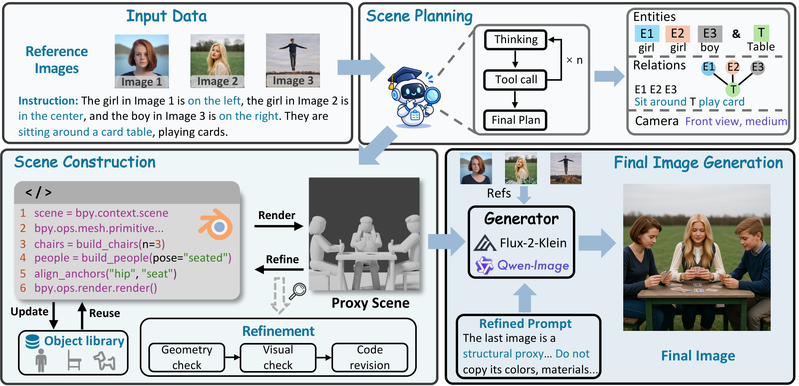
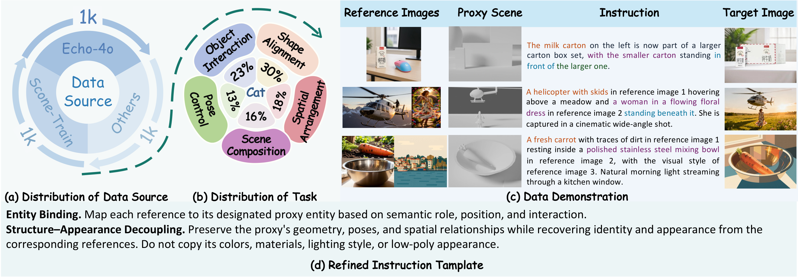
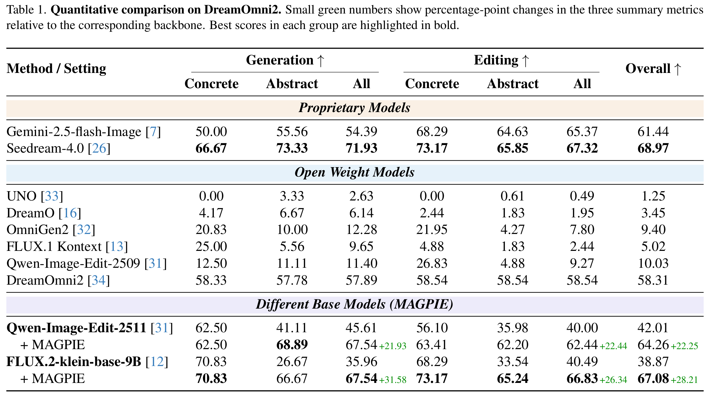
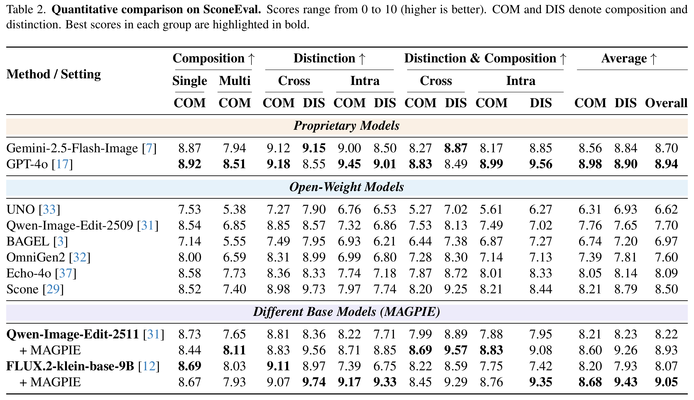
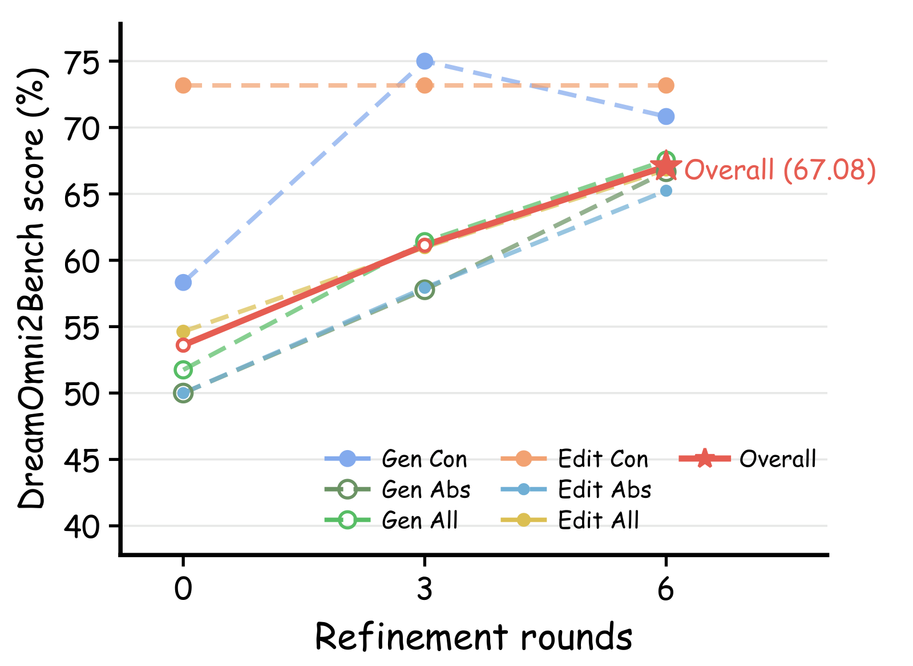
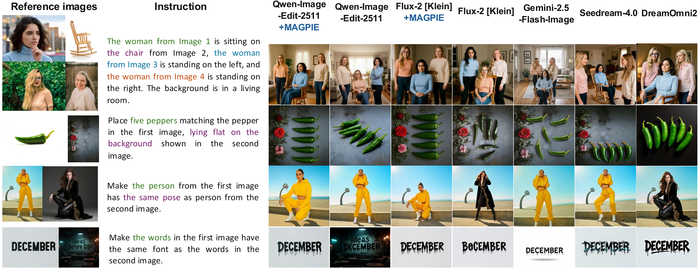

  

  
  
  
  

## 🔥 News

- **[2026.11.24]** We initialize the MAGPIE repository with the project overview, visual assets, and release roadmap. Stay tuned for the code and dataset release!

## 🎯 Todo List

Project release status:

- [x] Project README and Paper
- [ ] Training and inference code
- [ ] MAGPIE-Instruct-3K dataset

## 🎬 MAGPIE

**MAGPIE: Agentic Multi-Reference Image Generation via Executable Scene Construction** is a framework for composing images from multiple visual references and a natural language instruction. MAGPIE first constructs an executable Blender scene that specifies which subjects appear, how many instances are needed, and how they are arranged and interact. A coding agent checks the geometry and rendered view, then revises the scene before image synthesis. The refined proxy guides composition, while the original references provide each subject's identity and appearance.

  

  <i>MAGPIE Overview. The agent plans reference-associated entities, constructs an executable 3D proxy, and refines it using geometric and visual feedback. An adapted image generator follows the refined composition while preserving appearance from the bound references.</i>

## 🔍 Contributions

- **Executable scene construction for multi-reference generation.** MAGPIE instantiates compositional intent as a simplified 3D scene, making entity selection, instance counts, spatial relationships, and interactions available for inspection and correction before synthesis.
- **Geometry- and vision-guided agentic refinement.** A structured coding harness combines reusable procedural builders, explicit reference-to-entity bindings, geometric verification, and visual review to refine scene programs.
- **MAGPIE-Instruct-3K.** We construct **3,187 examples** pairing references and instructions with executable Blender programs, proxy renderings, and target images. Lightweight LoRA adaptation teaches generators to use proxy structure while preserving reference-specific appearance.
- **Improvements across two backbones and benchmarks.** On DreamOmni2, MAGPIE improves overall success by **22.25 percentage points with Qwen** and **28.21 points with FLUX**. On SconeEval, MAGPIE with FLUX achieves **9.05 overall**, the highest score among the models evaluated in the paper.

## 📑 MAGPIE-Instruct-3K

MAGPIE-Instruct-3K provides supervision for proxy-guided, reference-grounded image synthesis. Its **3,187 examples** cover five compositional tasks: **object interaction, shape alignment, pose control, spatial arrangement, and scene composition**. Each example includes reference images, an instruction, an executable Blender program, a proxy rendering, and a target image. Proxy-target pairs are filtered for entity inclusion and counts, spatial arrangements, poses and interactions, and framing and visibility.

**Dataset release: coming soon.**

  

  <i>MAGPIE-Instruct-3K Overview. Data sources, task distribution, representative examples, and the proxy-aware instruction template for binding reference subjects to proxy entities and separating structural guidance from appearance.</i>

## 🚀 Quick Start

**Code and model checkpoints are coming soon.** Setup instructions, scene construction, training, and inference commands will be added with the code release.

The paper evaluates MAGPIE with **Qwen-Image-Edit-2511** and **FLUX.2-klein-base-9B**. Both generators are adapted using rank-32 LoRA for five epochs on MAGPIE-Instruct-3K. At inference, the scene-construction agent receives the reference images and instruction, with up to six proxy-refinement rounds and early stopping.

## 📊 Results Analysis

### 1️⃣ Performance Comparison on DreamOmni2

Success rates are reported as percentages; higher is better. Generation and editing each include concrete and abstract tasks. Results include proprietary models, open-weight baselines, and MAGPIE with two backbones.

  

  <i>Performance comparison on DreamOmni2. Small green numbers indicate percentage-point gains over each backbone; bold follows the paper's main table.</i>

MAGPIE raises overall success from **42.01% to 64.26%** with Qwen and from **38.87% to 67.08%** with FLUX. The generation / editing / overall gains are **+21.93 / +22.44 / +22.25** percentage points for Qwen and **+31.58 / +26.34 / +28.21** for FLUX.

### 2️⃣ Performance Comparison on SconeEval

Scores range from 0 to 10; higher is better. **COM** denotes composition and **DIS** denotes distinction. The table reports the full set of subtasks and aggregate scores.

  

  <i>Performance comparison on SconeEval, including all composition, distinction, and joint subtasks. COM and DIS denote composition and distinction; higher is better.</i>

MAGPIE improves both composition and subject distinction with either backbone. With FLUX, the overall score increases from **8.07 to 9.05**.

### 3️⃣ Effect of Proxy Refinement

  

  <i>With the adapted FLUX generator fixed, aggregate generation and editing scores improve as the refinement budget increases. Overall success rises from 53.61% without refinement to 67.08% with up to six refinement rounds.</i>

## 🔭 Visualizations

  
<i>Click to collapse or expand visual examples.</i>

### Qualitative Comparison on DreamOmni2

  

  <i>Qualitative comparison of Qwen and FLUX with and without MAGPIE, alongside Gemini-2.5-Flash-Image, Seedream-4.0, and DreamOmni2.</i>

## 📖 Citation

The paper link and BibTeX citation will be added with the public paper release.

## 📒 License

License information will be provided with the code and dataset releases.
